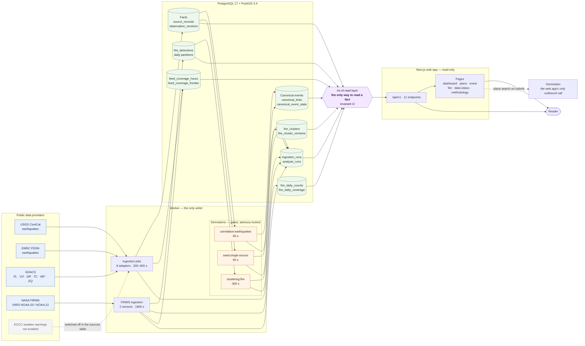
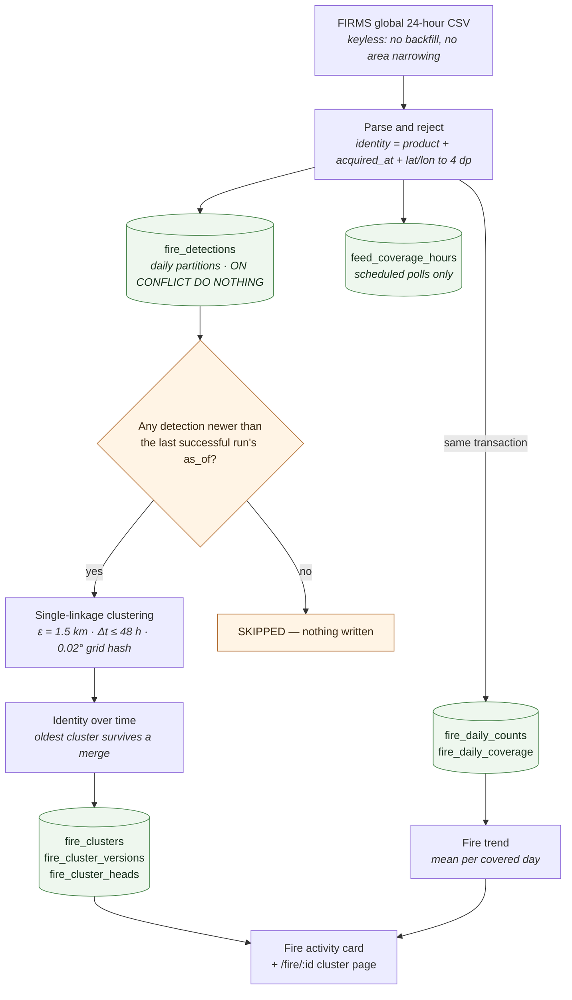
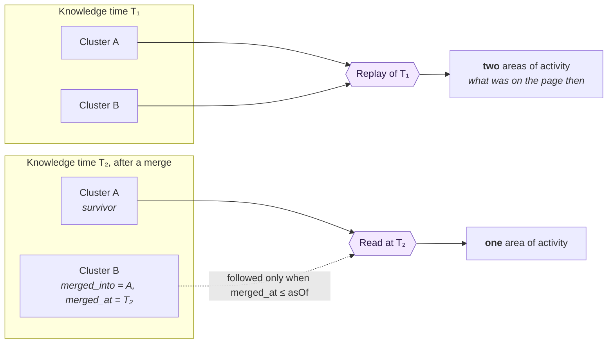
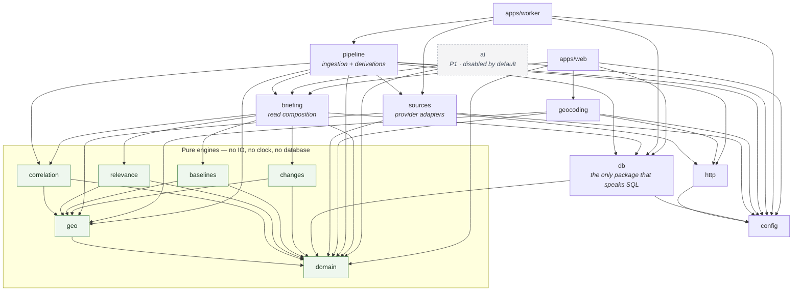
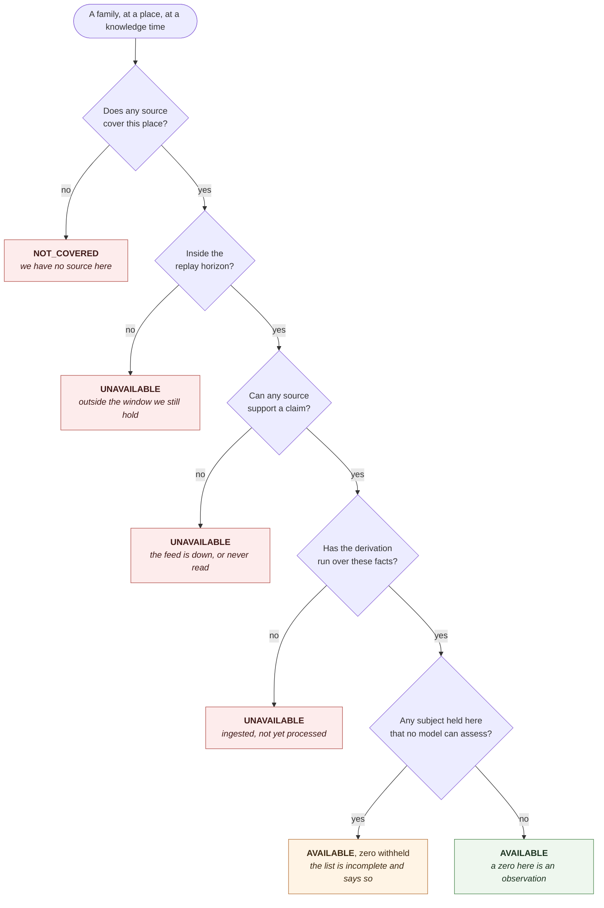

# GeoNerva — System Diagrams

> Status: **current as of v1.0.0-rc.1 (2026-09-24)**. These diagrams describe what the code does
> today, not a target state. Where a path is switched off or deliberately absent, the diagram says
> so rather than omitting it — the same rule the product applies to its own data.
>
> `ARCHITECTURE.md` is the prose authority and `DOMAIN_MODEL.md` owns the table shapes. If they
> disagree with a picture here, they are right and the picture is stale.

---

## 1. The whole system

Public providers on the left, a reader on the right, and exactly one process that writes.

**What the shape is telling you**

- **One writer.** The worker is the only process that writes facts. The web app is read-only, and
  its single outbound call is Nominatim on an explicit place submit (ADR-028) — never during a
  briefing.
- **Everything readable goes through the as-of layer.** Invariant I2 makes it the only path to a
  fact, which is what allows any answer to be reproduced for a past knowledge time.
- **FIRMS bypasses the fact store entirely**, and that is deliberate — see §2.
- **A derivation is not the same as an ingestion.** Ingestion records what a provider said;
  a derivation decides what it means. They fail, and degrade, independently.
- **ECCC is drawn, not omitted.** No weather-warning source is enabled, so that family answers
  `NOT_COVERED` rather than an empty list. "We have no source here" and "nothing is happening" are
  different statements and the product never merges them.

---

## 2. The fire path, which is shaped unlike everything else

NASA FIRMS answers a different question from every other provider: roughly 230,000 pixel detections
a day, with no identifiers, no revisions and no concept of an event. Forcing that through
`observation_versions` would mean a fact store that is 99.9 % thermal pixels, so **no P0 adapter
writes an observation version with hazard type `THERMAL_ACTIVITY`** (ADR-011, DOMAIN_MODEL §4.9).

**Three properties that are easy to get wrong**

- **The daily aggregate is written inside the ingestion transaction**, from the detections
  themselves, and does not depend on clustering having run (ADR-040). So a clustering outage
  degrades the cluster cards without corrupting the long-term series.
- **The coverage ledger is written for scheduled polls only.** A manual run produces detections
  with no covered hours, which makes every day `NOT_COVERED` and the trend permanently refuse —
  correct, and surprising the first time.
- **A day GeoNerva did not read every hour of is excluded from both means, never counted as zero.**
  Detection counts depend on overpasses, cloud and view angle as much as on fire.

---

## 3. Why a replay can be trusted

GeoNerva's defining claim is that it can answer *what did you know at time T*, and that the answer
does not drift as the present changes. Facts are versioned, and **derived state that is not a
version obeys the same rule through its own knowledge time** (ADR-039, invariant I16).

The mechanics, all of which were verified against live data for the release candidate:

- A detection's membership carries **its own knowledge time** — `cluster_assigned_at` is the
  clustering run's `as_of` — so a replay from before the run sees the detection in no cluster.
- **A merge never re-points a detection.** It is recorded on the absorbed cluster and resolved at
  read time, which is what keeps the older replay intact. On the release candidate, a replay of
  19:50 showed the 0 merges known then, 20:30 showed 987, and the present showed 1,121.
- `cluster_assigned_at IS NULL` means the knowledge time is **unknowable**, and such a row is
  excluded from every as-of read rather than given a guessed one.

---

## 4. Package dependency direction

Enforced by `dependency-cruiser` in CI, not by convention. Arrows point the only way a dependency
is allowed to run; changing this requires an ADR.

Four rules this encodes, each with a reason:

- **Only `packages/db` talks to PostgreSQL.** Every other package receives a connection or a row.
- **Pure engines import no IO, no clock and no framework**, which is what lets a stated distance or
  relevance band be re-derived from a stored row years later.
- **Only `packages/http` may use raw network modules**, because it owns the host allowlist, the SSRF
  checks and the size caps (ADR-028).
- **`apps/web` may not import `apps/worker`**, and may not write facts at all.

---

## 5. How a claim earns the right to be stated

The availability model is the reason GeoNerva can be quiet without being misleading. Five answers,
and none of them collapses into another.

The distinction that does the most work is the last one. A GDACS wildfire event has no relevance
model, so it is **counted rather than dropped** — which is what makes the fire card say *"GeoNerva
is holding fire activity here that it has no model to describe, so this list is not complete"*
instead of *"no fire activity to report"*. Reporting the second over an event the map was drawing
was a real defect, fixed for the release candidate.

Independence is judged the same way. A GDACS republication of a USGS earthquake is a
`DERIVED_COPY` link and **never counts as corroboration**, so that event reads two links and *one*
independent source. On the release candidate: 4 earthquakes `AGREE` with two independent sources,
33 `DERIVED_ONLY` with one.
